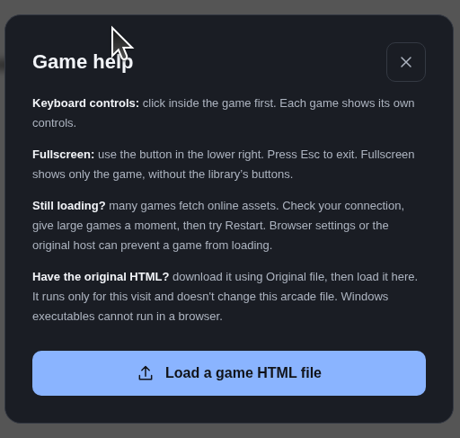

# Browser-games
A compiled library of hundreds of games in one html file for you convenience. Also supports embedding your own html game files.
# Installation
Click on the releases page and download the zip file "gimkit-login.html.zip". Then, decompress it and simply double-click on it to run it in your browser. If you have some spare time on your hands, verify the sha-256 hash to make sure that the file hasn't been tampered with. The game is also password protected, so the password will be in the Releases page. Some games were built using Unity, which will not run in a normal file:/// extension, however, they are loaded with an emulator. All scratch games are converted into javascript by [Turbowarp](https://turbowarp.org).
# How this was created
Another person who I know got hold of a bunch of game files and decided to use an agent to vibe code them all into one file with basic password protection.
# Embedding your own games
At the sidebar at the bottom, you will find a button with the name "Help". Click on that and it will show a popup like this:

Now, click on the button that says "Load HTML" and now you can load any HTML game you want!
